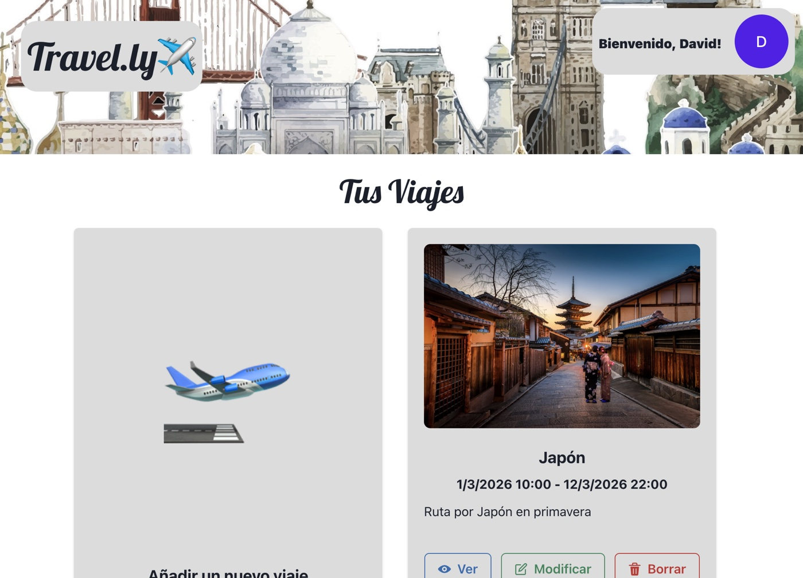
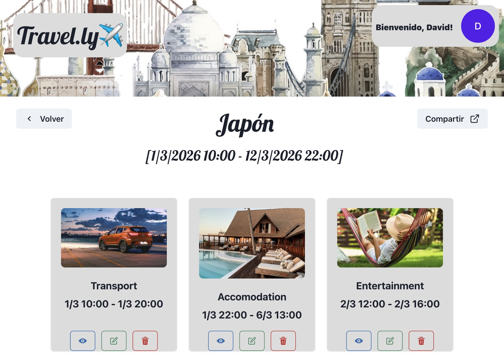
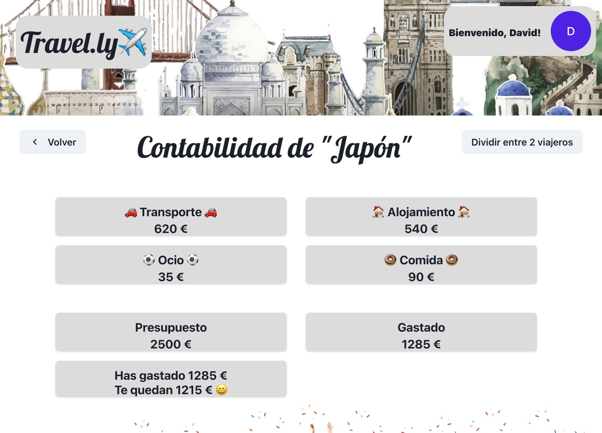

<div align="center">
  <h1>Travel.ly ✈️</h1>
  <p><strong>Plan the trip, not the spreadsheet.</strong></p>
  <p>A trip planner for organizing itineraries, activities, and shared budgets with the people you travel with.</p>

  <p>
    <a href="#getting-started"></a>
    <a href="#getting-started"></a>
    <a href="#getting-started"></a>
    <a href="#getting-started"></a>
    <a href="#getting-started"></a>
    <a href="#getting-started"></a>
  </p>

  <p>
    <a href="#-features"><strong>Features</strong></a>
    ·
    <a href="#-product-tour"><strong>Product Tour</strong></a>
    ·
    <a href="#-getting-started"><strong>Getting Started</strong></a>
    ·
    <a href="#-api"><strong>API</strong></a>
    ·
    <a href="#-architecture"><strong>Architecture</strong></a>
  </p>
</div>

<br>

<div align="center">
  
</div>

<br>

---

## ✨ Features

Travel.ly keeps everyone on a trip aligned on where you're going, what you're doing, and what it's costing:

<table>
  <tr>
    <td width="50%" valign="top">
      <h3>🗺️ Trip Planning</h3>
      <ul>
        <li><strong>Create and edit trips:</strong> dates, budget, and number of travelers in one place.</li>
        <li><strong>Public sharing link:</strong> share a read-only view of a trip with people who don't have an account.</li>
        <li><strong>Email notifications:</strong> get notified by email whenever a trip is created, modified, or deleted.</li>
      </ul>
    </td>
    <td width="50%" valign="top">
      <h3>📌 Categorized Activities</h3>
      <ul>
        <li><strong>Four categories:</strong> Transport, Accommodation, Leisure, and Food.</li>
        <li><strong>Rich activity details:</strong> price, dates, location, and attached documents per activity.</li>
        <li><strong>Full CRUD:</strong> add, update, and remove activities from a trip at any time.</li>
      </ul>
    </td>
  </tr>
  <tr>
    <td width="50%" valign="top">
      <h3>💰 Shared Budget Tracking</h3>
      <ul>
        <li><strong>Spend by category:</strong> aggregated expenses compared against the trip's budget.</li>
        <li><strong>Split between travelers:</strong> divide the trip's cost across everyone going.</li>
      </ul>
    </td>
    <td width="50%" valign="top">
      <h3>🔐 Google Sign-In</h3>
      <ul>
        <li><strong>OAuth 2.0 access:</strong> sign in with a Google account via <code>@react-oauth/google</code>.</li>
        <li><strong>No local passwords:</strong> account access is delegated entirely to Google.</li>
      </ul>
    </td>
  </tr>
</table>

---

## 🖼️ Product Tour

| Your Trips | Activities by Category | Trip Budget |
| :---: | :---: | :---: |
|  |  |  |
| *Every trip as a card, with its dates and travelers at a glance.* | *Transport, Accommodation, Leisure, and Food, side by side.* | *Spend broken down by category and compared against the budget.* |

---

## 🚀 Getting Started

### Requirements

- Node.js
- Docker (to run MongoDB)
- A Google Cloud project with an OAuth 2.0 Client ID

### 1. Configure Google OAuth (required)

Sign-in will not work out of the box. `packages/frontend/src/main.tsx` initializes `<GoogleOAuthProvider clientId="">` with an **empty** client ID, so a freshly cloned repo cannot authenticate any user.

1. Create OAuth 2.0 credentials in the [Google Cloud Console](https://console.cloud.google.com/apis/credentials).
2. Copy the generated Client ID into the `clientId` prop of `<GoogleOAuthProvider>` in `packages/frontend/src/main.tsx`.

### 2. Configure the backend environment

Create a `.env` file at the repository root (there is no `.env.example` to copy from):

```env
PORT=3333
MONGO_URI=mongodb://localhost:27017/travelly
CLIENT_NODEMAILER=your-gmail-address@gmail.com
SECRET_NODEMAILER=your-gmail-app-password
CLIENT_SENDER_NODEMAILER=recipient@example.com
```

- `CLIENT_NODEMAILER` / `SECRET_NODEMAILER` — the Gmail account (and app password) Nodemailer sends from.
- `CLIENT_SENDER_NODEMAILER` — the address that receives trip notifications.

### 3. Start MongoDB

```bash
docker-compose up -d
```

> **Troubleshooting:** `docker-compose.yml` pins `mongo:latest`. At the time of writing, that tag resolves to a MongoDB build that fails to start on Linux kernel 6.19+, which current Docker Desktop releases use — it errors with `MongoDB cannot start: Linux kernel versions 6.19 and newer has a known incompatibility` (see MongoDB's [SERVER-121912](https://jira.mongodb.org/browse/SERVER-121912)). If the container won't start, edit your local copy of `docker-compose.yml` to use `mongo:8.2` instead.

### 4. Install dependencies and run

```bash
npm install
npm run serve
```

- **Frontend:** [http://localhost:4200](http://localhost:4200)
- **Backend API:** [http://localhost:3333/api](http://localhost:3333/api)
- **MongoDB:** `localhost:27017`

### Other scripts

| Command | Description |
| --- | --- |
| `npm run serve` | Start frontend and backend together |
| `npm run frontend` | Start only the frontend |
| `npm run backend` | Start only the backend |
| `npm run lint` | Run ESLint with `--fix` |
| `npm run format` | Run Prettier with `--write` |
| `npm run test:backend` | Run the backend test suite |

---

## 🧭 App Routes

| Route | Description |
| --- | --- |
| `/` | Sign-in |
| `/travels` | Your trips |
| `/new-travel` | Create a trip |
| `/travel/:id` | Trip activities |
| `/budget/:id` | Trip budget |
| `/user` | User profile |
| `/travel/shared/:id` | Public, read-only shared trip view |

---

## 🔌 API

All endpoints are served under `/api`:

```text
GET    /api/status
GET    /api/travels/:ownerId
GET    /api/travel/:id
POST   /api/travels
PUT    /api/travels/:id
DELETE /api/travels/:id
POST   /api/travels/:id/activities
PUT    /api/travels/:travelId/activities/:activityId
DELETE /api/travels/:travelId/activities/:activityId
```

---

## 🏗️ Architecture

Travel.ly is an Nx 16 monorepo with four packages:

```text
packages/frontend      React 18.2, Chakra UI 2.5, TypeScript 4.9, webpack, SCSS
packages/backend       Express 4, Mongoose 7, MongoDB
packages/frontend-e2e  Cypress 13
packages/backend-e2e   Jest
```

The backend follows a hexagonal architecture around a single bounded context, `Travels`:

```text
Travels/
├── domain/           Travel, Activity, and Expenses entities, plus the
│                     TravelRepository and Notifier port interfaces
├── application/      One use case per class, each exposing a single run()
│                     method, with DTOs under DTOs/UseCasesDTO/
└── infrastructure/   Controllers, MongoTravelRepository + TravelMapper +
                      TravelSchema, and NodemailerNotifier
```

Dependencies only point inward — `infrastructure` depends on `application`, which depends on `domain` — and `main.ts` is the single composition root wiring everything together.

Other notable dependencies: Formik 2.2 + Yup 1.2 for forms, Nodemailer 6.9 for email, and Jest 29 for testing.

---

## 📄 License

This repository currently has conflicting license declarations: [`LICENSE`](LICENSE) contains the **GNU GPL v3** text, while `package.json` declares `"license": "MIT"`. Neither should be treated as authoritative until this is reconciled — check with the maintainer before relying on either, and consider it an open item to unify.
